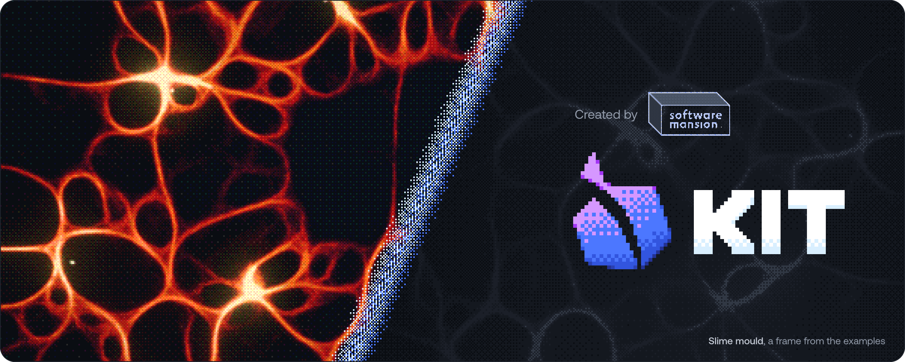
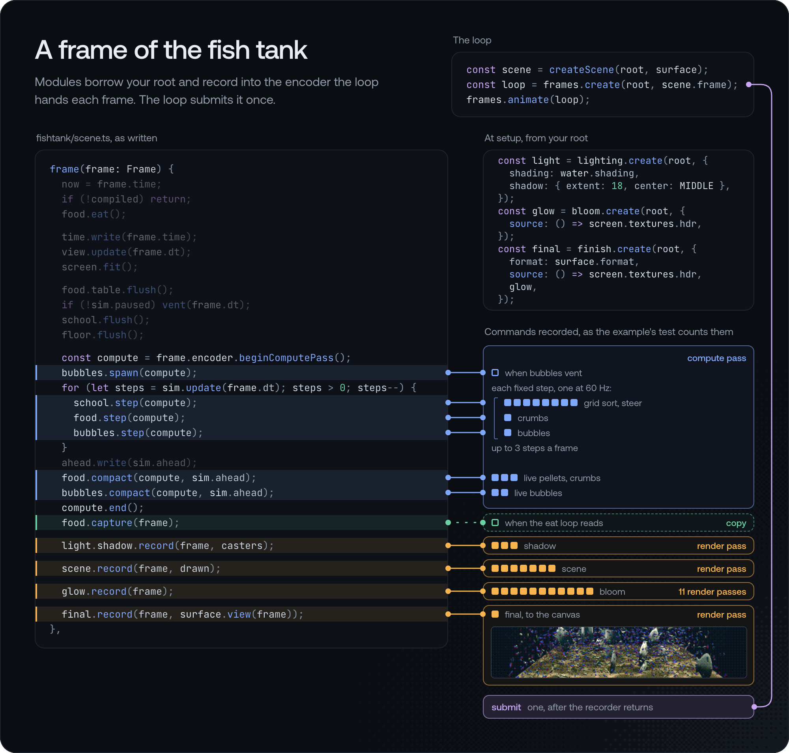
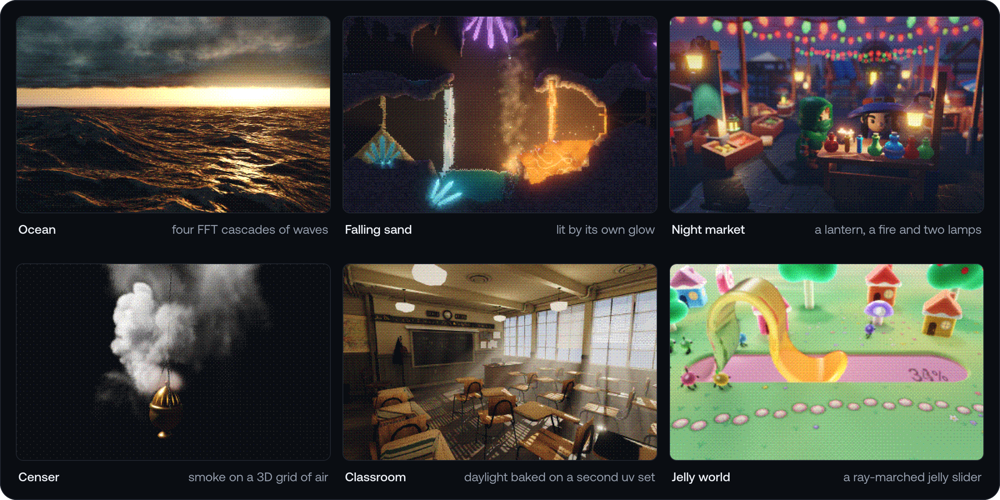
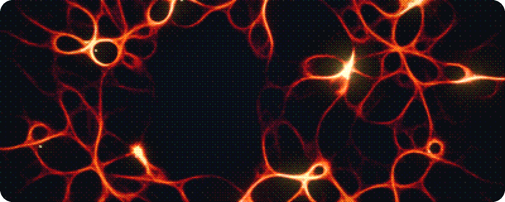

<div align="center">



[Documentation](https://docs.swmansion.com/typegpu-kit/) —
[Getting started](https://docs.swmansion.com/typegpu-kit/getting-started/) —
[Examples](https://docs.swmansion.com/typegpu-kit/examples/)

</div>

**TypeGPU Kit** is a set of GPU modules on [TypeGPU](https://typegpu.com), for WebGPU and React
Native. Use the ones you want and write the rest yourself. A module borrows your TypeGPU root and
records into the encoder or pass you give it. You own the loop, the canvas and the pass order, and
each frame submits once.

```ts
import { tgpu } from 'typegpu';
import { bloom, frames, finish, targets } from '@typegpu/kit';
import * as web from '@typegpu/kit/web';

const root = await tgpu.init();
const surface = web.surface(root, document.querySelector('canvas')!);
const screen = targets.create(root, surface, { hdr: { format: 'rgba16float', sampled: true } });
const source = () => screen.textures.hdr;

const glow = bloom.create(root, { source });
const final = finish.create(root, { format: surface.format, source, glow });

frames.animate(
  frames.create(root, (frame) => {
    screen.fit();

    const scene = frame.encoder.beginRenderPass({ colorAttachments: { view: screen.views.hdr } });
    // the scene, in linear colour
    scene.end();

    glow.record(frame);
    final.record(frame, surface.view(frame));
  }),
);
```

## Install

Start a new Vite project with the kit, the TypeGPU plugin and one of four
[starter scenes](https://docs.swmansion.com/typegpu-kit/starter-scenes/):

```sh
npm create @typegpu/kit my-scene
```

Or add the kit to a project you have:

```sh
pnpm add @typegpu/kit typegpu @typegpu/noise @typegpu/color
pnpm add -D vite unplugin-typegpu typescript@npm:tsover@6.0.2 @webgpu/types
```

[Setting up a project](https://docs.swmansion.com/typegpu-kit/getting-started/#setting-up-a-project)
adds the bundler plugin, React Native and coding agents.

## A frame



You make modules once, at setup, from your root. Each frame, the loop hands its encoder to the
modules you call, in the order you call them. The fish tank's frame records one compute pass, a
copy when it reads the bites back, and 14 render passes: the shadow, the scene, 11 for bloom and
the final pass. Then it submits once.

## What's in it

- **Frame:** a frame loop, clocks with fixed steps and springs, coroutines, pipeline warm-up,
  helpers for writing modules and an owner that frees what a scene made.
- **Passes and targets:** scene passes, last-frame history, render targets that resize together,
  textures baked from a shader function, mip chains, cameras and shared bind groups.
- **Data on the GPU:** tables of rows, live lists, state machines, a neighbour grid, workgroup
  reduce and scan, and a radix sort.
- **Reading back:** buffer readback, event counters, a picker and dynamic resolution.
- **Rendering:** shapes, a mesh pool that holds them and glTF models, instances, impostors, skinned
  poses, lines with joins, caps and dashes, lighting with a sun, sky, fog, point lights and
  shadows, environment light, physically based shading and materials, and ambient occlusion.
- **Post-processing:** bloom, auto exposure, FXAA, TAA, depth of field, and a final pass with
  tone curves, grading, a vignette and dither.
- **Particles and text:** particles with your own update and shading, trails, and MSDF text from
  fonts you bake at build time, laid out in JavaScript.
- **Assets:** a glTF reader with skins and animation clips, images from files, pixels or
  Radiance HDR, and [camera and video](https://docs.swmansion.com/typegpu-kit/kit/video/) frames.
- **Hosts:** web and React Native canvases, scene files hosted on either, and scenes on a worklet
  runtime with `useScene`.
- **Tools:** a recording root for tests without a GPU, Dawn tests, GPU timers, a pipeline census
  and a GPU debug panel for any WebGPU page.

The [module map](https://docs.swmansion.com/typegpu-kit/map/) shows every module by area.

## Examples

<a href="https://docs.swmansion.com/typegpu-kit/examples/"></a>

Every [example](https://docs.swmansion.com/typegpu-kit/examples/) opens full-screen with a GPU
profiler, and its source is in [`packages/typegpu-kit-examples/src`](packages/typegpu-kit-examples/src).
The same examples run on an iPhone in the Expo app in
[`apps/typegpu-kit-native`](apps/typegpu-kit-native).

## Tutorials and recipes



Tutorials build an example from an empty canvas, starting with
[Slime mould](https://docs.swmansion.com/typegpu-kit/tutorials/slime-mould/).
[Write a module](https://docs.swmansion.com/typegpu-kit/tutorials/write-a-module/) builds a module
of your own. Recipes combine modules for one job. The
[docs](https://docs.swmansion.com/typegpu-kit/) list them all.

## Coding agents

The package ships a skill for coding agents,
`node_modules/@typegpu/kit/skills/typegpu-kit/SKILL.md`: the kit's rules and every module, linked
to the docs as Markdown in the package's `docs/`. Install it with
`pnpm dlx @tanstack/intent@latest install`, or name it in your own `AGENTS.md`. The site serves
each page as Markdown too, listed in
[`llms.txt`](https://docs.swmansion.com/typegpu-kit/llms.txt).

## Repository

```sh
pnpm install
pnpm dev      # docs and examples, in a WebGPU browser
pnpm dev:host # the same over LAN HTTPS, for WebGPU on a phone
pnpm test     # types, lint, format, unit and GPU tests, then the docs build
```

- [`packages/typegpu-kit`](packages/typegpu-kit): `@typegpu/kit`.
  - `src/geometry`: TypeGPU's geometry, public at `@typegpu/kit/geometry`. Edit it only as its
    README says.
  - `src/sort`: TypeGPU's radix sort, which only `sorter` imports. Edit it only as its README says.
- [`packages/typegpu-create-kit`](packages/typegpu-create-kit): `@typegpu/create-kit`, which
  `npm create @typegpu/kit` runs, and its starter scenes.
- [`packages/typegpu-kit-pull`](packages/typegpu-kit-pull): the box and card animation the docs
  and the native app share.
- [`packages/typegpu-kit-examples`](packages/typegpu-kit-examples): the examples, shared by the
  docs and the native app.
- [`apps/typegpu-kit-docs`](apps/typegpu-kit-docs): the docs, and the host that runs every
  example page.
- [`apps/typegpu-kit-native`](apps/typegpu-kit-native): an Expo app that runs the examples on an
  iPhone.


## Community Discord

[Join the Software Mansion Community Discord](https://discord.swmansion.com) to chat about
TypeGPU Kit, TypeGPU and other Software Mansion libraries.

## TypeGPU Kit is created by Software Mansion

[](https://swmansion.com)

Since 2012 [Software Mansion](https://swmansion.com) is a software agency with experience in
building web and mobile apps. We are Core React Native Contributors and experts in dealing with
all kinds of React Native issues. We can help you build your next dream product –
[Hire us](https://swmansion.com/contact/projects?utm_source=typegpu-kit&utm_medium=readme).
