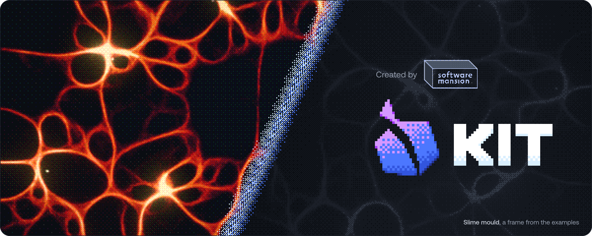

# TypeGPU Kit



A set of GPU modules on [TypeGPU](https://typegpu.com), for WebGPU and React Native. Use the ones you want and write the rest yourself. A module borrows your TypeGPU root and records into the encoder or pass you give it. You own the loop, the canvas and the pass order, and each frame submits once.

[Documentation](https://docs.swmansion.com/typegpu-kit/) · [Getting started](https://docs.swmansion.com/typegpu-kit/getting-started/) · [Tutorials](https://docs.swmansion.com/typegpu-kit/tutorials/slime-mould/) · [Examples](https://docs.swmansion.com/typegpu-kit/examples/) · [Module map](https://docs.swmansion.com/typegpu-kit/map/)

```ts
import { tgpu } from 'typegpu';
import { bloom, frames, finish, targets } from '@typegpu/kit';
import * as web from '@typegpu/kit/web';

const root = await tgpu.init();
const surface = web.surface(root, document.querySelector('canvas')!);
const screen = targets.create(root, surface, { hdr: { format: 'rgba16float', sampled: true } });
const source = () => screen.textures.hdr;

const glow = bloom.create(root, { source });
const final = finish.create(root, { format: surface.format, source, glow });

frames.animate(
  frames.create(root, (frame) => {
    screen.fit();

    const scene = frame.encoder.beginRenderPass({ colorAttachments: { view: screen.views.hdr } });
    // the scene, in linear colour
    scene.end();

    glow.record(frame);
    final.record(frame, surface.view(frame));
  }),
);
```

## Install

Start a new Vite project with the kit, the TypeGPU plugin and one of four [starter scenes](https://docs.swmansion.com/typegpu-kit/starter-scenes/):

```sh
npm create @typegpu/kit my-scene
```

Or add the kit to a project you have:

```sh
pnpm add @typegpu/kit typegpu @typegpu/noise @typegpu/color
pnpm add -D vite unplugin-typegpu typescript@npm:tsover@6.0.2 @webgpu/types
```

[Setting up a project](https://docs.swmansion.com/typegpu-kit/getting-started/#setting-up-a-project) adds the bundler plugin and React Native.

## Entries

| Entry | Contents |
| --- | --- |
| `@typegpu/kit` | Every module as a namespace, such as `frames`, `passes`, `lighting` and `bloom`, and the helpers `byStage`, `unfilled`, `owner` and `memo` exported flat. |
| `@typegpu/kit/<module>` | One module, such as `@typegpu/kit/frames`. On React Native, import from these. |
| `@typegpu/kit/inject`, `@typegpu/kit/owner`, `@typegpu/kit/memo` | The flat helpers, by subpath for React Native. |
| `@typegpu/kit/geometry` | TypeGPU's geometry: meshes, lines, joins and caps. |
| `@typegpu/kit/web` | A canvas surface, pointer input, orbit controls, video elements, and `web.host` for running a scene on a canvas. |
| `@typegpu/kit/native` | A React Native canvas surface. |
| `@typegpu/kit/hosting`, `@typegpu/kit/native/host`, `@typegpu/kit/native/react`, `@typegpu/kit/native/runtimes` | Running a scene on a root and surface, on React Native canvases, on a worklet runtime or the JS thread, and `useScene`. |
| `@typegpu/kit/testing`, `@typegpu/kit/testing/dawn`, `@typegpu/kit/testing/warnings`, `@typegpu/kit/testing/failOnWarnings` | A recording root and an offscreen surface for tests without a GPU, Dawn roots for GPU tests, and test setup that fails on TypeGPU warnings. |
| `@typegpu/kit/debug`, `@typegpu/kit/debug/recording`, `@typegpu/kit/debug/gpuDebugPanel` | The GPU debug panel for any WebGPU page, also as a React component, its frame recorder, and a pipeline census. |
| `@typegpu/kit/fontBaker` | The font baker, also the `typegpu-kit-bake-font` command. |
| `@typegpu/kit/fonts/*` | Inter Display SemiBold, baked for `font`. |

Required peers are `typegpu`, `@typegpu/noise` and `@typegpu/color`. Optional peers belong to single entries: React Native hosts need `react-native`, `react-native-webgpu` and `react-native-worklets`, `useScene` needs `react`, the font baker `@pmndrs/glyph`, and Dawn tests `webgpu` and `vitest`.

## Coding agents

Point your coding agent at `skills/typegpu-kit/SKILL.md` in this package: the kit's rules and every module, linked to the docs as Markdown in `docs/`, with the examples' source. Install it with `pnpm dlx @tanstack/intent@latest install`, or name `node_modules/@typegpu/kit/skills/typegpu-kit/SKILL.md` in your own `AGENTS.md`.

## License

MIT
